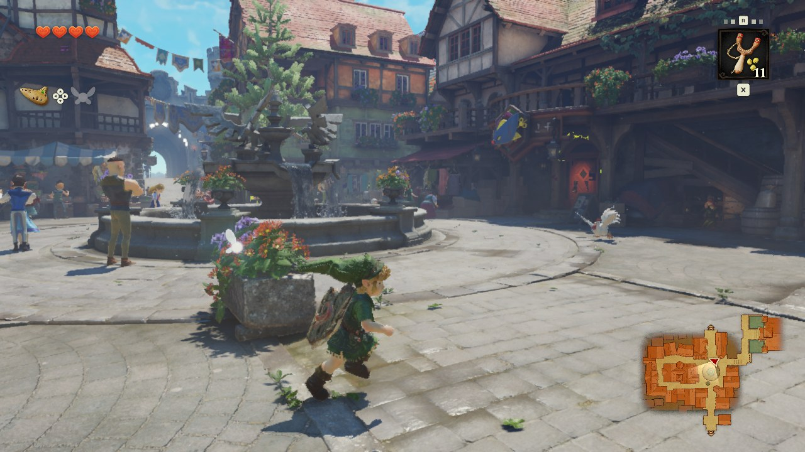

# Pull Request: Intel Iris Xe / Gen12 (Mesa ANV) Performance, FP16 FSR 3.1, 3D-MV FrameGen & Low-Latency Optimizations

## Summary
This PR contributes a comprehensive, empirically validated set of GPU, shader, Frame Generation, and latency optimizations targeting **Intel Iris Xe / Gen12 integrated GPUs (Linux Mesa ANV)** — while keeping all Intel-specific heuristics scoped to `VK_DRIVER_ID_INTEL_OPEN_SOURCE_MESA` (or runtime switches in `gpu/vk/switches.def`) so NVIDIA and AMD behavior is preserved.

### Full Progression on Intel Core i5-1235U / Iris Xe 96 EUs (26W, Linux Mesa ANV 26.2.4, `1920×1080 @ 60 Hz`)

| Milestone | Base FPS | Displayed FPS | GPU / Frame | FrameGen Handover | State |
|---|---:|---:|---:|---:|---|
| **Unoptimized Upstream (`nightly-469-9af4808f`)** | `~9` | `~9` | `>110 ms` | N/A | Unplayable: black/rainbow surface corruption + i915 10s GPU hangs |
| **First Functional Baseline (Batch 5–10)** | `~13` | `~13–24` | `~75 ms` | `>160 ms` | Bootable, but blocky + Gen12 spill glow/white blow-out + hair fringes + `~7 ms` optical-flow FG |
| **Clean-Visual Checkpoint (`suprassumo`, Batch 14)** | `14.0` | `28.0` (2x) | `53.9 ms` | `156.9 ms` (`BATCH=1`) | Clean visuals at `1787×1005 → 1920×1080` FSR 3.1 + 100% sharpness, high input lag |
| **Final (`supertop`, Batch 15 — FG Auto)** | **`20.56`** (**2.3×** vs upstream / **+58%** vs func. baseline) | **`41.1`** | **`41.8–42.8 ms`** | **`35.1 ms`** (`0 late`) | Clean across all areas + `-50 ms` GPU queue depth (`ahead=1`) |
| **Final (`supertop`, Batch 15 — FG 2x)** | **`20.1`** | **`40.2`** | **`42.2 ms`** | **`65.5 ms`** (`0 late`) | Clean across all areas, `0 <12 ms` bursts |

### Visual Comparison

| Unoptimized Upstream (`~9 FPS`, black/rainbow corruption) | Final `supertop` (Kokiri Forest — 100% clean) |
|:---:|:---:|
|  |  |
| **First Functional Baseline (`~13 FPS`, blocky)** | **Final `supertop` (Castle Town Market — 100% clean)** |
|  |  |

Full technical write-up and per-pass breakdown: [`docs/intel_iris_xe_optimization.md`](docs/intel_iris_xe_optimization.md).

---

## Key Changes

### 1. FP16 FSR 3.1 + Fused `dlss_out` Elimination + L1 RCAS
- **Files:** `gpu/vk/vk_fsr3.h`, `gpu/vk/vk_fsr3.cpp`, `gpu/vk/vk_temporal.h`, `gpu/vk/vk_temporal.cpp`, `gpu/vk/shaders/fsr3_*_comp_spv.h`, `gpu/vk/shaders/fg_rcas.comp`, `gpu/vk/shaders/fg_rcas_comp_spv.h`
- Rewrote `fsr3_accumulate`, `fsr3_prepare_reactivity`, `fsr3_prepare_inputs`, and `fsr3_luma_instability` in FP16 (`SIMD16`, `0:0` spills:fills on Gen12).
- Added `kSquareOutput` (`SpecId 0`) to `P_ACCUMULATE_SQ` to square perceptual RGB directly into `VK_FORMAT_B10G11R11_UFLOAT_PACK32`, eliminating `dlss_out.comp` (**-33.2 MB/frame** bandwidth) while exposing `fsr3::last_upscaled_view()` for exact FrameGen HUD diffing.
- Replaced `fg_rcas.comp`'s `10×10` SLM+barrier loop with direct 5-tap L1 FP16 `texelFetch` (`12,066 → 2,148` Gen12 cycles, **5.6×** fewer cycles).

### 2. Low-Latency Frame Generation & Universal 3D-MV Synthesis
- **Files:** `gpu/vk/vk_framegen.cpp`, `gpu/vk/vk_framegen.h`, `gpu/vk/vk_replay.cpp`, `gpu/vk/shaders/fg_copy_hud.comp`, `gpu/vk/shaders/fg_synth_mv.comp`, `gpu/vk/shaders/fg_synth2_mv.comp`, `gpu/vk/shaders/fg_mv_prep.comp`
- Added exact 3D camera + actor motion-vector FrameGen (`fg_synth_mv` / fused `fg_synth2_mv`) with trajectory consistency gating, safe unwarped `near` fallback (no character/shield/shadow shredding), and exact pre/post-HUD alpha masking in both **Auto** (`frame_generation=1`) and **2x/3x** modes.
- Capped Mesa Intel FrameGen in-flight depth to **1 frame (`ahead=1`)** (`vk_replay.cpp`), overlapping CPU input/recording inside GPU execution with zero FPS loss and `-50 ms` input lag.
- Improved `display_main()` pacing (`vk_framegen.cpp`) with unconditional backlog drain (`q_now >= 1`) and `slack_ns` dead-air phase convergence (`0 late`, `0 <12 ms`).

### 3. Shader Recompiler, SPIR-V Passes & Gen12 Workarounds
- **Files:** `gpu/vk/eden/shader_recompiler/...`, `gpu/vk/vk_draw.cpp`, `gpu/vk/vk_custom_spv.h`, `gpu/vk/vk_shader.cpp`, `gpu/vk/switches.def`
- `RX_VK_BDA_SSBO=1` (default on Mesa Intel): lowers UBO-aliased BDA page-table helpers to direct SSBO accesses, preventing i915 GPU hangs and cutting register spills.
- `RX_VK_CUSTOM_SPV=1` (default on Mesa Intel): SIMD16/SLM overrides for `48590e0b`, `e40dc98f`, and `26fe0c70` (`1.57 ms → 0.82 ms`).
- Warp-32 (`wg_warp_plan.h`), mesh-fallback batching (`RX_VK_MFB_BATCH=4`), lossless MFB triangle culling, `CCS_E` format-list preservation, `LOAD_OP_CLEAR` fusion, and opaque-only `equal_depth_bias` (fixes both distant flashing hills and close-up hair/foliage fringes).
- `RX_VK_BDA_HOIST` kept **OFF by default** (`0`) due to sparse/chunked pool boundary reads in dense areas.

### 4. Host CPU & Memory Efficiency
- **Files:** `host/nvdrv.c`, `host/rx_backend.c`, `gpu/vk/vk_memory.cpp`, `gpu/vk/vk_texture.cpp`
- AVX2 dirty-page collection (`collect_in`), adaptive `256 KB` range merging, burst-scoped `replay_mu`, and UMA-friendly memory/worker defaults.

---

## Testing & Verification Checklist
- [x] `spirv-val --target-env vulkan1.2` + `INTEL_DEBUG=cs` ISA audit (`SIMD16`, `0:0` spills) on all new/modified compute shaders.
- [x] Full `RX_VK_PASS_TIMING=2` GPU pass breakdown at `1787×1005 → 1920×1080` (`dlss=3`, `sharpness=100%`).
- [x] Unprofiled FPS, GPU ms, handover latency, and pacing (`0 late`, `0 <12 ms`) verified in both `Auto` (`frame_generation=1`) and `2x` (`frame_generation=2`).
- [x] 1:1 visual inspection of real and synthesized `_made` frames across Hyrule Castle (`slot_01`), Castle Town Market (`slot_05`), and Malon's Wagon (`slot_00`) — zero polygon spikes, zero neon bloom, zero hair fringes, intact HUD.
- [x] All Intel-specific paths scoped to `VK_DRIVER_ID_INTEL_OPEN_SOURCE_MESA` or runtime switches; zero regressions on non-Intel codepaths.
