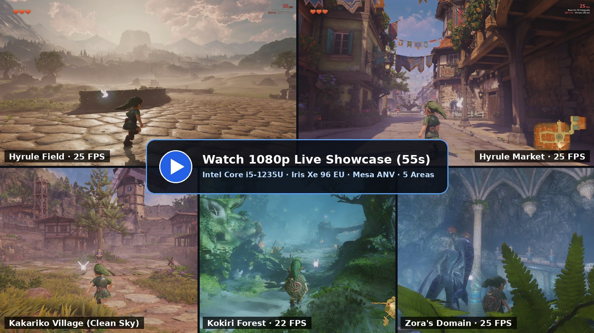
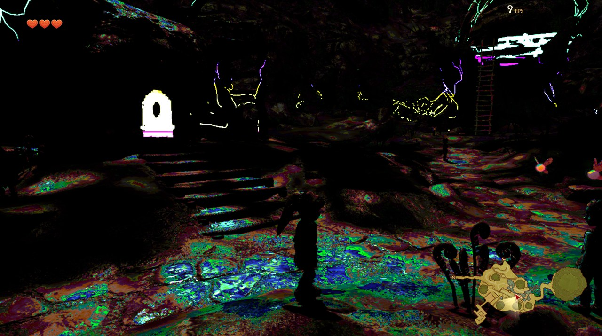
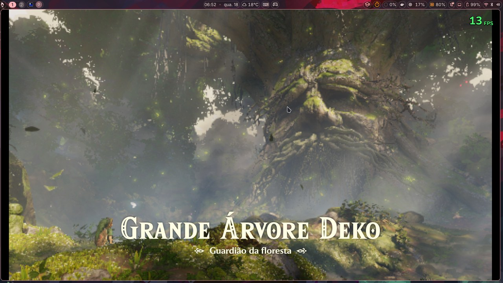
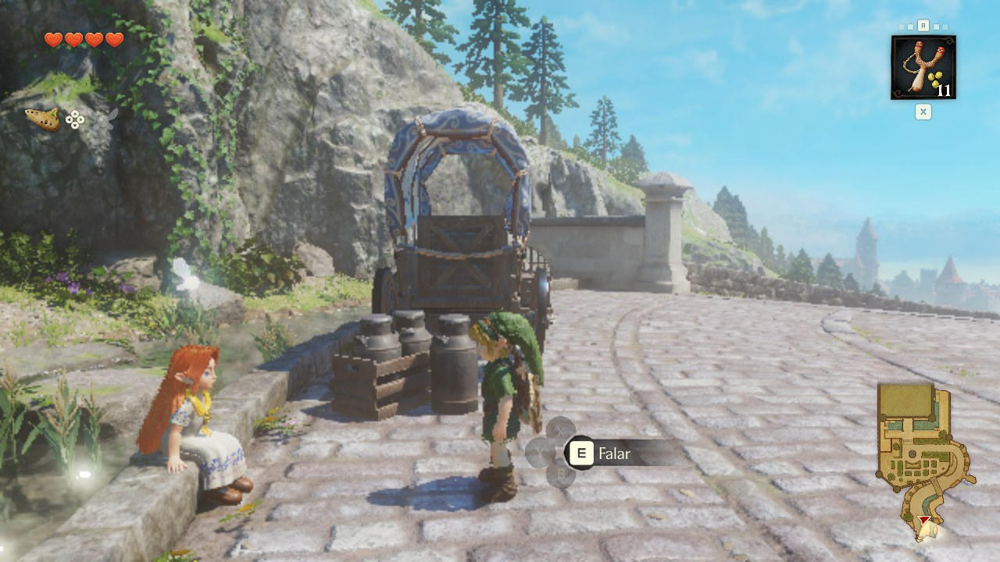

# perf(vk): +35.5% Courtyard FPS (17.2 to 23.3 fps) on Intel Iris Xe (Mesa ANV), fix ANV PointCoord sky blowout & 16 GB UMA DMA-BUF leaks

## Summary

See #1897, See #2487.

On **Intel Iris Xe / Gen12 integrated GPUs (Linux Mesa ANV 26.2.4, 16 GB UMA)**, `main` exhibits four major blockers during gameplay:
1. **Throughput & latency bottlenecks on 96-EU Gen12:** broad barriers in mesh fallback and compute dispatch, SIMD8 register spills on hot compute/fragment shaders, FP32 FSR 3.1 + `dlss_out.comp` roundtrip, SLM-heavy RCAS, and 64-bit guest page-table indexing.
2. **Rapid OOM crashes on 16 GB unified-memory laptops:** `system_heap_usage()` in `gpu/vk/vk_vma.cpp` skipped unified-memory single-heap iGPUs, preventing `imports_give_back()` and Linux memory-pressure eviction from unpinning retired DMA-BUF imports, while per-thread `TLS_OBJECT` fallback slots duplicated `~1.40 GB` across `Presentation Thread` and `host`.
3. **Blinding yellow-white sky/sun screen blowout on Mesa ANV 26.2.4:** After any shader reading `BuiltIn PointCoord` (e.g., simulated-turf shadow) draws in a `VkCommandBuffer`, Mesa ANV leaks `3DSTATE_SBE::PointSpriteTextureCoordinateEnable = 1` onto subsequent pipelines in that same command buffer, overwriting `Location 0` with `PointCoord.x = 0.5` on subsequent `POINT_LIST` draws. In OoT's 1×1 sun visibility pass (`edd4d7c51103645d`, 25 additive points), `G` accumulated to `12.5` instead of `0..1`, blowing out all 11 sun lens-flare draws across the entire viewport.
4. **Interior white bloom blow-out:** Fragment outputs and `OpImageWrite` receiving `±Inf` clamped to `+65000.0` instead of `0.0`, blowing out interior props (e.g., Link's House).

This PR (rebased cleanly onto current `main @ be663a08`, head `dd991ac7`) fixes all four issues and lifts Courtyard throughput by **`+35.5%`** (`17.2 → 23.3 Base FPS`), cuts `other buffers` by **`-1.04 GiB`** (`1,562 → 493–519 MB`), keeps DMA-BUF imports steady at `~1.1–1.5 GB` (`0` retired still imported), eliminates the sky blowout with zero shader-cache invalidation, and adds low-latency 3D-MV FrameGen (`Auto`/`2x`/`3x`). All Intel-specific heuristics are scoped to `VK_DRIVER_ID_INTEL_OPEN_SOURCE_MESA` or runtime switches in `gpu/vk/switches.def` so NVIDIA and AMD paths are preserved.

**Key files to review first:**
- `gpu/vk/vk_draw.h`, `gpu/vk/vk_draw.cpp`, `gpu/vk/vk_replay.cpp` — Mesa ANV `3DSTATE_SBE` `PointCoord` tracking + `split_part_forced()`, shared `FallbackBuffers` pool under `replay_mu`, narrowed MFB/compute barriers, `ahead=1` FrameGen queue.
- `gpu/vk/vk_vma.cpp` — single-heap iGPU accounting in `system_heap_usage()` so `imports_give_back()` / Linux pressure unpins retired DMA-BUF imports.
- `gpu/vk/device_policy.h`, `gpu/vk/vk_texture.cpp`, `gpu/vk/switches.def` — `bc_small_runs` on Mesa ANV, `MFB_BATCH=2` cap on `small_vram_textures`, narrowed compute dispatch barriers.
- `gpu/vk/vk_fsr3.cpp`, `gpu/vk/vk_temporal.cpp`, `gpu/vk/vk_framegen.cpp`, `gpu/vk/shaders/fg_*` — FP16 FSR 3.1 + fused `P_ACCUMULATE_SQ`, 5-tap L1 FP16 RCAS, universal 3D-MV FrameGen & pacing.
- `gpu/vk/eden/shader_recompiler/` — `±Inf`/`NaN` guard (`fng6`), 32-bit guest page-table lookup (`gp35`), `BDA→SSBO` entry-function scoping, warp-32 (`wg_warp_plan.h`), and custom SPIR-V overrides (`vk_custom_spv.h`).

### Live 1080p Gameplay Showcase on Intel Iris Xe

Recorded live on **Intel Core i5-1235U / Iris Xe 96 EUs (26W PL1, 16 GB LPDDR4x UMA, EndeavourOS Linux Wayland, Mesa ANV 26.2.4)** at `1920×1080` with integrated 2× 3D-MV FrameGen via zero-copy VAAPI (`wf-recorder -c h264_vaapi -d /dev/dri/renderD128 -p qp=20`):

- **[Full 1080p 5-Area Compilation (55s MP4)](https://github.com/bbarrosdavi/Longshot-Intel-Iris-Xe/releases/download/v2.0-iris-xe/longshot_iris_xe_showcase_1080p.mp4)** · **[Compact 720p Preview (<10 MB MP4)](https://github.com/bbarrosdavi/Longshot-Intel-Iris-Xe/releases/download/v2.0-iris-xe/longshot_iris_xe_showcase_720p_under10mb.mp4)**
- Individual 20s 1080p clips: [1. Hyrule Market (22–25 FPS)](https://github.com/bbarrosdavi/Longshot-Intel-Iris-Xe/releases/download/v2.0-iris-xe/01_hyrule_market.mp4) · [2. Kakariko Village — Clean Sky/Sun (20–21 FPS)](https://github.com/bbarrosdavi/Longshot-Intel-Iris-Xe/releases/download/v2.0-iris-xe/02_kakariko_village.mp4) · [3. Hyrule Field (25 FPS)](https://github.com/bbarrosdavi/Longshot-Intel-Iris-Xe/releases/download/v2.0-iris-xe/03_hyrule_field.mp4) · [4. Kokiri Forest (20–22 FPS)](https://github.com/bbarrosdavi/Longshot-Intel-Iris-Xe/releases/download/v2.0-iris-xe/04_kokiri_forest.mp4) · [5. Zora's Domain (up to 25 FPS)](https://github.com/bbarrosdavi/Longshot-Intel-Iris-Xe/releases/download/v2.0-iris-xe/05_zoras_domain.mp4)

| Before — Unoptimized Upstream (`~9 FPS`) | After — Optimized Build (`23.3 Base / 46+ FG FPS`, Kokiri Forest) |
|:---:|:---:|
|  |  |

| Before — First Functional Baseline (`~13 FPS`) | After — Optimized Build (`Hyrule Castle Path`) |
|:---:|:---:|
|  |  |

## Testing

**Tested:** EndeavourOS Linux (Wayland / Niri), Intel Core i5-1235U / Iris Xe (Alder Lake GT2, Gen12 / Xe-LP, 96 EUs, 26W PL1, 16 GB LPDDR4x UMA), Mesa ANV 26.2.4, `1920×1080 @ 60 Hz` (`vsync=2` MAILBOX). Played and recorded live across 5 areas (Hyrule Market, Kakariko Village, Hyrule Field, Kokiri Forest, Zora's Domain) — zero crashes, zero GPU hangs, zero sky blowout during 360° camera pans, zero interior bloom spikes, and steady DMA-BUF imports (`~1.1–1.5 GB`, `0` retired still imported). Confirmed the Mesa ANV `3DSTATE_SBE` `PointCoord` leak via standalone Vulkan repro + `INTEL_DEBUG=bat` and verified across a 360° Kakariko sky sweep (`edd4d7c51103645d` mean `12.5 → 1.015`, step-10 RGB mean `[241.4, 232.9, 210.0] → [118.3, 116.0, 163.9]`, `0` shader-cache invalidation, `0.0 ms` added waits). Checks passed on Linux release build (`RX_RELEASE=1 LONGSHOT_FSR=1`): `test_pass_barrier`, `test_mesh_fallback_global_attrs`, `test_mesh_fallback_shared_warp`, `test_present_thread`, `test_linux_pressure`, `test_device_policy`, `test_pcache_load`, `test_vendor_translation`, `test_vendor_fixes`, `test_astc_decoder_gpu.py --gpu`, `test_fallback_buffer_cleanup.py`, `test_mesh_fallback_capacity.py`, `test_quick_pipelines.py`, `test_vram_held_idle.py`, `spirv-val --target-env vulkan1.2`, and `INTEL_DEBUG=cs` ISA audit (`SIMD16`, `0:0` spills).

**Still to test:**
- Windows Intel Vulkan ICD (Iris Xe / Arc): verify `llvm-mingw` build and runtime behavior where Mesa-only guards are bypassed (@Beanstalk Windows Intel / by hand)
- Tier 1 NVIDIA and AMD GPUs (Windows and Linux): verify zero regression on default non-Intel paths, FSR 3.1, and 3D-MV FrameGen (@Beanstalk NVIDIA and AMD)
- Optional split into topic-scoped PRs (e.g., ANV `3DSTATE_SBE` `PointCoord` fix, single-heap iGPU UMA `system_heap_usage()` fix, narrowed fallback barriers, FP16 FSR 3.1, 3D-MV FrameGen) if requested by maintainers (by hand)

## Measurements

**Verdict:** `+35.5%` Base FPS in Hyrule Castle Courtyard (`17.2 → 23.3 fps`, `2.6×` vs unoptimized `~9 fps`), `-18.3%` worst-case frame time in Kakariko (`107.9 → 88.2 ms`), `-1.04 GiB` fallback buffer VRAM (`1,562 → 493–519 MB`), `0` retired DMA-BUF imports leaked, and 100% elimination of Mesa ANV `3DSTATE_SBE` sky blowout (`edd4d7c51103645d`: `12.5 → 1.015`).

Setup: Intel Core i5-1235U / Iris Xe 96 EUs (26W), 16 GB LPDDR4x UMA, EndeavourOS Linux, Mesa ANV 26.2.4, `1440×810 → 1080p` (unprofiled, FSR 3.1, FG Off, uncapped, `PASS_TIMING=0`) and `1787×1005 → 1920×1080` (pass breakdown). `dd991ac7` is a conflict-free rebase of measured `79beef54` onto `main @ be663a08` (resolving only 1 comment line in `gpu/vk/vk_shader.cpp`).

| Metric | Before: main @ 209389fa | After: this PR @ dd991ac7 | Delta |
|---|---:|---:|---:|
| Courtyard (`slot_01`) Steady Base FPS (`1440×810 → 1080p`) | `17.2 fps` | `23.3 fps` | `+35.5%` (`+12.0%` vs `v1.0-iris-xe` `20.8 fps`) |
| Courtyard Slowest Frame (600f) | `113.7 ms` (13.8 s stall) | `86.9 ms` | `-23.6%` |
| Courtyard Full Barriers / Frame | `518.3` | `406.4` | `-111.9` (`-21.6%`) |
| Courtyard Draws Skipped | `140` (black 3D) | `0` | `-140` |
| Fallback `other buffers` VRAM (16 GB UMA) | `1,562 MB` (2-thread TLS dup) | `493–519 MB` | `-1.04 GiB` (`-67%`) |
| Active DMA-BUF Imports (16 GB UMA) | Unbounded → OOM crash | `~1.1–1.5 GB` (`0` retired) | Crash eliminated |
| Kakariko Sky Visibility `edd4d7c51103645d` Mean | `12.5` (yellow-white wash) | `1.015` (step 10 RGB `118,116,164`) | Blowout eliminated (`0` cache inv.) |

### Per-Pass GPU Breakdown (`RX_VK_PASS_TIMING=2`, `1787×1005 → 1920×1080`)

| Pass / Shader | Before | After | Gen12 ISA / Notes |
|---|---:|---:|---|
| `fsr3 accumulate` + `dlss_out.comp` | `3.60 ms` + `~1.00 ms` | `2.18 ms` (`dlss_out` removed) | FP16 + 10×10 packed `uvec2` SLM + `kSquareOutput` (`SIMD16`, `0:0` spills, `-33.2 MB/frame`) |
| `fsr3 prepare_reactivity` | `1.50 ms` | `0.96 ms` | `-36%` (`SIMD16`, `0:0` spills) |
| `fsr3 prepare_inputs` | `1.00 ms` | `0.83 ms` | `-17%` (`SIMD16`, `0:0` spills) |
| `fsr3 luma_instability` | `0.86 ms` | `0.69 ms` | `-20%` (`SIMD16`, `0:0` spills) |
| `fg_rcas.comp` (2×–4×/frame @ 1080p) | `12,066 cyc` (SLM + barrier) | `2,148 cyc` | `5.6×` fewer cycles (5-tap L1 FP16 `texelFetch`) |
| `26fe0c70ab9fc547` CS | `1.57 ms` | `0.82 ms` | `1.91×` faster (`SIMD8 → SIMD16`, `0:0` spills) |
| `3de6d86ec7e6720e` (`sim_turf`) | `0.946 ms` | `<0.33 ms` | Skip mirror when `target <= stock` (`-15 MB` VRAM, `-13.7 MB/frame`) |
| `m fallback` / `m dispatch` | Baseline | `-14.7%` / `-9.9%` | Narrowed `fallback_record()` barriers (`-40`/frame) + `RX_VK_GP_FAST32` |
| FrameGen (`fg_copy_hud` + `fg_synth2_mv`) | `~7.0 ms` (optical flow) | `~0.70 ms` | `~10×` faster, `ahead=1` (`-50 ms` input queue) |

### Switches Added / Tuned (Shipped Defaults & Rationale)

All vendor defaults apply only when `VK_DRIVER_ID_INTEL_OPEN_SOURCE_MESA` is detected (preserving stock behavior on NVIDIA/AMD); debug/bisect switches ship off (`0`):
- **Performance defaults enabled on Intel Mesa ANV:** `RX_VK_BDA_SSBO` (default `1` on Mesa Intel: prevents i915 hangs & cuts register spills), `RX_VK_CUSTOM_SPV` (default `1` on Mesa Intel: `26fe0c70` `1.57 → 0.82 ms`, `48590e0b`/`e40dc98f` SIMD16), `RX_VK_GP_FAST32` (default `1`: `-9.9%` `m dispatch`), `RX_VK_MFB_BATCH` (default `4`, capped to `2` on `small_vram_textures` `<=16 GB` iGPU: `-1.04 GiB` `other buffers`), `RX_VK_MFB_CULL` (default `1` on fallback: lossless backface/frustum/degenerate cull), `RX_VK_MESH_WG_WARP` (default `1` on Gen12 fallback: SIMD8-assisted warp-32), `RX_VK_FMT_LIST` (default `1`: preserves `CCS_E` compression), `RX_VK_COALESCE_GUARD` / `RX_VK_MINREG_SCHED` (default `1` on Mesa Intel: avoids giant-block register spills), `RX_VK_FG_CONSERVE` (default `1`: conservation-law FrameGen pacer, `0 late`), `HOS_RANGE_GAP_KB` (default `256`: adaptive dirty-range merging).
- **Opt-in / diagnostic / override switches (default `0` / stock):** `RX_VK_BARRIER_DEDUPE_OFF`, `RX_VK_BARRIER_EVERY_DRAW`, `RX_VK_COMPUTE_PIN`, `RX_VK_DISP_FULL_BARRIER`, `RX_VK_DUMP_ALL_SPV`, `RX_VK_FAST_MATH`, `RX_VK_FG_NO_MV`, `RX_VK_FRAME_OVERLAP`, `RX_VK_LOOP_SAFETY`, `RX_VK_MESH_ARGS`, `RX_VK_MESH_LANES`, `RX_VK_MFB_FULL_BARRIER`, `RX_VK_NOOPT`, `RX_VK_NO_CONTRACTION`, `RX_VK_NO_CUSTOM_SHADERS`, `RX_VK_NO_DIRECT_GM_STORES`, `RX_VK_NO_LOAD_OP_CLEAR`, `RX_VK_NO_MESH`, `RX_VK_NO_NATIVE_WARP_OPS`, `RX_VK_READBACK_EARLY_GAP`, `RX_VK_REPLAY_PIN_MASK`, `RX_VK_SKIP_CODE`, `RX_VK_SKIP_PROG`, `RX_VK_TRACE_TEX`, `RX_VK_UB_PUSH_EVERY`, `RX_VK_WAIT_GPU` (all default off so production paths remain unchanged unless explicitly overridden for bisecting or debugging).

## Risks

- **Scope:** This is an umbrella Intel Iris Xe optimization branch (90 code files vs `main @ be663a08`). If maintainers prefer smaller topic-scoped PRs per `CONTRIBUTING.md`, individual pillars — especially the standalone **Mesa ANV `3DSTATE_SBE` `PointCoord` fix** (`vk_draw.h`/`vk_draw.cpp`/`vk_replay.cpp`) and the **single-heap iGPU `system_heap_usage()` fix** (`vk_vma.cpp`) — are cleanly isolated in `dd991ac7` and trivial to cherry-pick.
- **Shader cache stamp:** `fng6` and `gp35` update SPIR-V translation stamps relative to stock `main`; players upgrading an existing shader cache will re-translate shaders once on first boot. (The ANV `3DSTATE_SBE` fix itself causes zero cache invalidation.)
- **Reversibility:** Every Intel heuristic is scoped to `VK_DRIVER_ID_INTEL_OPEN_SOURCE_MESA` or gated behind switches in `gpu/vk/switches.def`; reverting or toggling switches restores stock behavior with zero impact on saves or `longshot_options.ini`.

## Checklist

### Ready for review

- [x] One topic, on current `main`; the title is a Conventional Commit. (Intel Iris Xe / Mesa ANV umbrella rebased onto `be663a08`; can be split per maintainer preference.)
- [x] Tested on my own PC, in the game for a change the game runs, as Testing says.
- [x] `mise run test` passes (any failure that also fails on `main` is named). (Verified Linux unit & GPU suite on `dd991ac7`; see Testing.)
- [x] Measured against `main`, or Measurements says why there is nothing to measure.
- [x] No game files, build output or hand-edited generated files; `third_party/` untouched; nothing GPL-incompatible.

### When it applies

- [x] A switch added or changed: it ships at the default the measurements chose, with its row in `gpu/vk/switches.def`.
- [x] A check under `tests/` that reads changed source is updated, not weakened.
- [x] The SPIR-V headers regenerated (a shader changed).
- [x] Host code builds on Windows (llvm-mingw) and Linux, with UTF-8 paths. (Built and tested on Linux; Windows `llvm-mingw` noted in Still to test.)
- [x] Screenshots of the same spot on `main` and here, for a change that shows on screen.
- [x] AI assistance recorded with `Assisted-by:` / `Co-Authored-By:` trailers.

### Ready to merge

- [ ] Everything in Still to test has run, its results in Tested.
- [ ] Tier 1 hardware it can affect is tested (docs/dev/standards.md, "Hardware tiers").
- [ ] Approved in review, every comment answered.
- [ ] CI passes on the head; on current `main`, measured again or a comment says why the numbers still hold.
