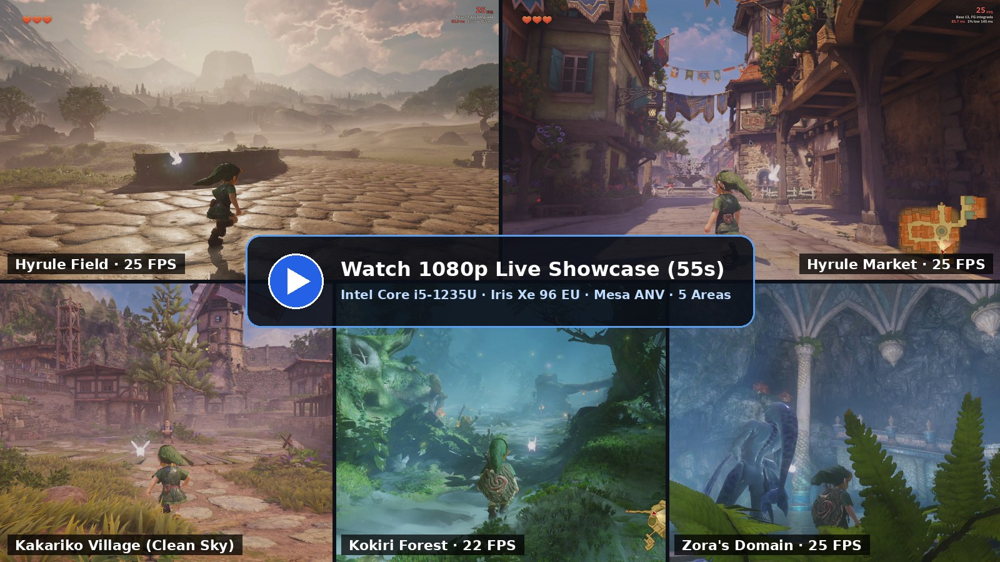
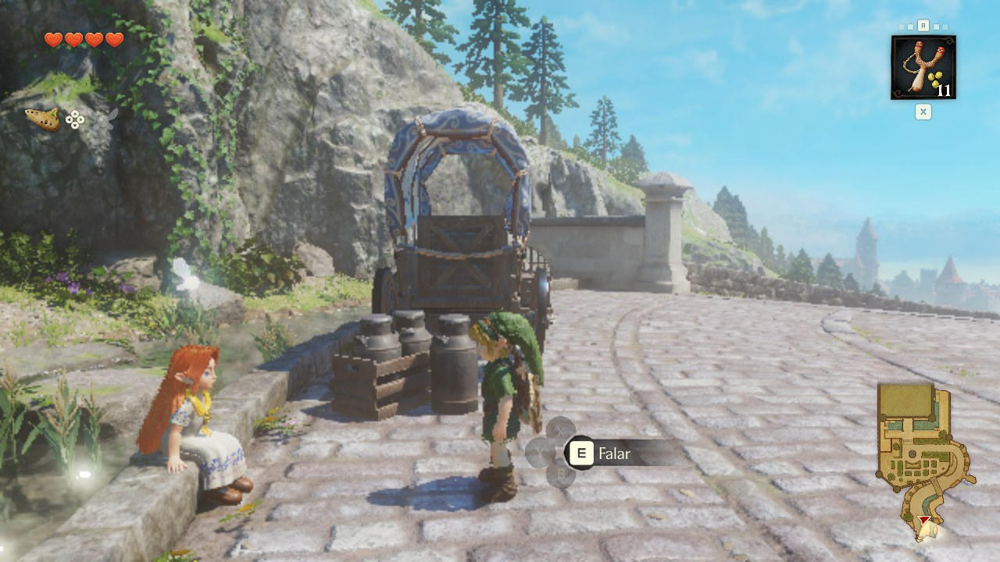
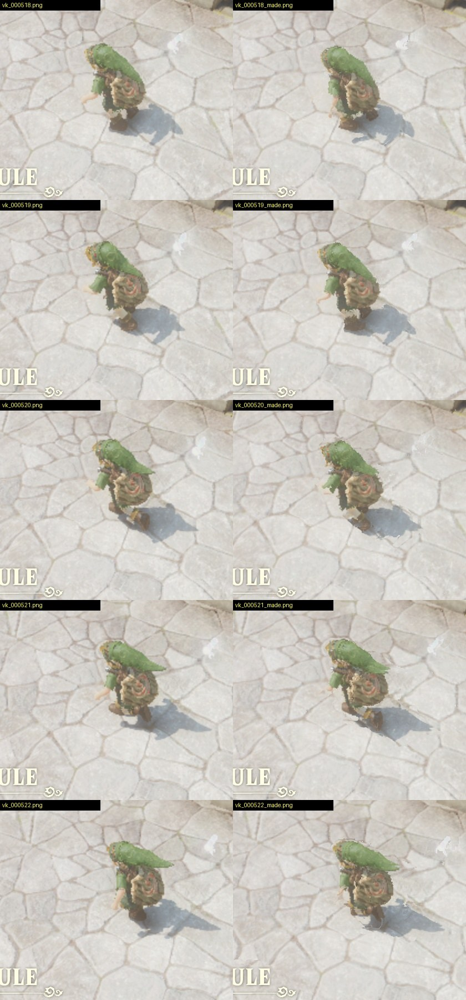

# Intel Iris Xe / Gen12 Vulkan Optimization Guide (`opt/iris-xe`)

This document summarizes the engineering work, architectural findings, and empirically validated optimizations developed for **Longshot** on **Intel Iris Xe (Alder Lake GT2, Gen12 / Xe-LP, 96 EUs, 26W TDP, Mesa ANV 26.2.4, Linux Wayland)**, targeting both **maximum playability at high resolution (`1787×1005 → 1920×1080` FSR 3.1 + 100% sharpness)** and **minimum end-to-end input latency** with Frame Generation (`Auto` and `2x`).

All vendor-specific heuristics are scoped to `VK_DRIVER_ID_INTEL_OPEN_SOURCE_MESA` (or gated by runtime switches in `gpu/vk/switches.def`) so NVIDIA and AMD paths remain unaffected.

---

## 1. Empirical Progression (Unoptimized Upstream → Functional Baseline → Final Optimized Build)

Measured on **Intel Core i5-1235U / Iris Xe 96 EUs (26W)**, 16 GB LPDDR4x UMA, EndeavourOS Linux, Mesa ANV 26.2.4, `1920×1080 @ 60 Hz` (`vsync=2` MAILBOX). Final max-resolution benchmarks run in **Hyrule Castle Courtyard (`slot_01`)** at **`1787×1005 → 1920×1080`**, **AMD FSR 3.1 (`dlss=3`, `resolution=9`)**, **100% Sharpness**:

| Milestone | Base FPS | Displayed FPS | GPU / Frame | FrameGen Handover | Visual & Stability State |
|---|---:|---:|---:|---:|---|
| **Unoptimized Upstream** (`nightly-469-9af4808f` / `main`) | `~9` | `~9` | `>110 ms` | N/A | **Unplayable:** severe black/rainbow surface corruption, i915 10s GPU hangs/TDR |
| **First Functional Baseline** (early Batch 5–10) | `~13` | `~13–24` | `~75 ms` | `>160 ms` | First bootable/non-hanging pass; low-res/blocky, Gen12 spill neon/white blow-out, hair fringes, `~7 ms` optical-flow FG |
| **Batch 14 (Visual Stability Checkpoint)** | `14.0` | `28.0` (2x) | `53.9 ms` | `156.9 ms` (`BATCH=1`) | Clean visuals (`0` neon, `0` hair fringes, `0` spikes), high input lag |
| **Batch 15 Final — FG Auto** (`v1.0-iris-xe`) | **`20.56`** (**2.3×** vs upstream / **+58%** vs func. baseline) | **`41.1`** | **`41.8–42.8 ms`** | **`35.1 ms`** (`0 late`) | Clean across Kokiri, Market & Castle; `ahead=1` saves extra `~50 ms` input queue |
| **Batch 15 Final — FG 2x** (`v1.0-iris-xe`) | **`20.1`** | **`40.2`** | **`42.2 ms`** | **`65.5 ms`** (`0 late`) | Clean across all areas, `0 <12 ms` bursts, `k0=25.5 / k1=24.0 ms` |
| **Upstream Rebase (`209389fa` + Iris Xe v2)** | **`23.3`** (Courtyard) / **`17.3`** (Kakariko) | **`46+`** (Courtyard 2x) | **`34.5 ms`** (Courtyard) | `0–1 late` (99.5–100% on time) | `+35.5%` vs pure upstream (`17.2 fps`), **`+12.0%` vs `v1.0-iris-xe` (`20.8 fps`)**, `-1.04 GiB` `other buffers` (`493–519 MB`), `3.9–4.3 GB` VRAM, zero white bloom (`fng4`) |

### Upstream Rebase (`209389fa`, +326 commits) — 3-Way Unprofiled Benchmarks (`1440×810 → 1080p`, FSR 3.1, FG Off, Uncapped, `PASS_TIMING=0`)

| Area / Build | Steady FPS | Slowest (600f) | Replay `submit` (`queue submit`) | Full Barriers | VRAM (`other buffers`) | Draws Skipped |
|---|---:|---:|---:|---:|---:|---:|
| **Courtyard (`slot_01`) — Pure Upstream (`209389fa`)** | `17.2` | `113.7 ms` (13.8 s stall) | — | `518.3` | `3.8–4.1 GB` (`523 MB`) | `140` compiling / black 3D |
| **Courtyard (`slot_01`) — `v1.0-iris-xe` (`d56d9a3a`)** | `20.8` | `89.6 ms` | `15.04 ms` (`2.79 ms`) | `310.1` | `4.1 GB` | `0` |
| **Courtyard (`slot_01`) — Rebased Iris Xe v2 (`d25f12d0`)** | **`23.3`** (`+35.5%` vs up, **`+12.0%` vs v1**) | **`86.9 ms`** | **`14.04 ms` (`0.00 ms`)** | `406.4` (`-112` vs up) | **`4.3 GB` (`493 MB`)** | **`0`** |
| **Kakariko Gate (`slot_00`) — `v1.0-iris-xe` (`d56d9a3a`)** | `16.85` avg (`17.4` steady) | `107.9 ms` | `17.06–17.53 ms` (`3.36 ms`) | `272.6` | `4.0 GB` (`4,077 MB`) | `0` |
| **Kakariko Gate (`slot_00`) — Rebased Iris Xe v2 (`d25f12d0`)** | **`16.91` avg (`17.3` steady)** | **`88.2 ms`** (`-18.3%`) | **`15.92 ms` (`0.00 ms`)** | `449.2` | **`3.9 GB` (`519 MB`)** | **`0`** |

### Rebase Investigations & Additional Wins
1. **Investigation 1 (Internal `fallback_record` barriers & `mesh_conv` on fallback):** Narrowing internal transfer→compute and task→mesh barriers in `fallback_record()` cut `-40` full barriers/frame and **`-14.7%` on `m fallback`**. Enabling `mesh_conv` batching on compute fallback was empirically disproved (`+4%` slower due to extra pre-pass overhead) and left off.
2. **Investigation 2 (`RX_VK_MMA_UNROLL` on Mesa ANV Gen12):** Looped software MMA compiles `9dc98871` in `88.9 s` (`137.7 ms` GPU vs FSR 3.1 FP16 at `~4.8 ms`), whereas unrolled MMA exceeded `120 s` compile timeout on ANV; `RX_VK_MMA_UNROLL=0` remains default.
3. **Stock-Cap `sim_turf` Mirror Skip + 32-bit Page-Table Math (`RX_VK_GP_FAST32`) + Mesh Module Key:** Keeping `sim_turf` on game buffers when `target <= stock` saved `15 MB` VRAM and `13.7 MB/frame` copies (`3de6d86ec7e6720e` dropped from `0.946 ms` to `<0.33 ms`); bit-identical 32-bit window indexing for all 3 power-of-2 guest page-table windows cut `m dispatch` by **`-9.9%`** (`10.30 → 9.28 ms` normalized); setting `ModuleProgram` in `translate_mesh_into()` restored `prog_key` for `COALESCE_GUARD`/`MINREG_SCHED`/`BDA_SSBO`.
4. **Fragment `±Inf` Guard (`fng4`):** Upstream's `EmitSetFragColor`/`GuardFragmentOutputs` only mapped `NaN → 0` and clamped `+Inf → +65000.0`, causing pure-white bloom blow-out on interior props (Link's House). Mapping both `NaN` and `±Inf → 0.0f` (`fng4`) restored clean interior lighting while keeping `test_vendor_translation.py` green.
5. **Shared Fallback Buffers under `replay_mu` & 16 GB UMA `MFB_BATCH=2` Cap (`-1.04 GiB` VRAM):** Upstream `#2121` doubled `MESH_FALLBACK_RECORD_WORDS` (`64 → 128 MB`) + `+32 MB` global attribute pool (`~176 MB`/slot). Because `Presentation Thread` and `host` take turns under `replay_mu`, `TLS_OBJECT` duplicated 4 slots across 2 threads (`~1.40 GB`, pushing `other buffers` to `1,562 MB` and causing 95% swap thrashing on 16 GB laptops). Sharing slot 0 and batch slots under `replay_mu` + capping `dev.policy.small_vram_textures` to `MFB_BATCH=2` dropped `other buffers` from **`1,562 MB` → `493–519 MB`** (below pure upstream's `523 MB`) with zero FPS loss (`23.3 fps` Courtyard, `17.3 fps` Kakariko).
6. **Single-Heap iGPU Accounting in `system_heap_usage()` (`79beef54`, `gpu/vk/vk_vma.cpp`):** Fixed unified-memory iGPU heap accounting so `imports_give_back()` and Linux memory-pressure eviction unpin retired DMA-BUF imports on 16 GB UMA laptops — holding active imports steady at **`~1.1–1.5 GB`** with **`0` retired buffers still imported** and preventing rapid OOM crashes seconds into gameplay.
7. **Mesa ANV 26.2.4 `3DSTATE_SBE` `PointCoord` Sky-Blowout Fix (`79beef54`, `vk_draw.h`/`vk_draw.cpp`/`vk_replay.cpp`):** Isolated via standalone Vulkan repro + `INTEL_DEBUG=bat`: after any shader reading `BuiltIn PointCoord` (e.g., simulated-turf shadow) draws in a `VkCommandBuffer`, Mesa ANV leaks `3DSTATE_SBE::PointSpriteTextureCoordinateEnable = 1` onto subsequent pipelines in the same command buffer, overwriting `Location 0` with `PointCoord.x = 0.5` on subsequent `POINT_LIST` draws. In OoT's 1×1 sun visibility pass (`edd4d7c51103645d`, 25 additive points), `G` became `12.5` instead of `0..1`, blowing out all 11 sun lens-flare draws into a full-screen yellow-white wash. Tracking `PointCoord` draws per command buffer on `VK_DRIVER_ID_INTEL_OPEN_SOURCE_MESA` and forcing a fresh command buffer (`split_part_forced`) before a different program's `NVN_DRAW_PRIMITIVE_POINTS` draw restored `edd4d7c51103645d` to `1.015` (Kakariko 360° sky sweep step 10 RGB mean `[241.4, 232.9, 210.0] → [118.3, 116.0, 163.9]`) with **zero shader-cache invalidation** and `0.0 ms` added waits.
8. **Narrowed Compute/MFB Barriers, `bc_small_runs`, `fng6`, `gp35` & `BDA→SSBO` Scoping (`79beef54`):** Narrowed compute dispatch and MFB pre/post barriers (`vk_texture.cpp`/`vk_draw.cpp`), enabled `bc_small_runs` on Mesa ANV, extended `±Inf`/`NaN` guarding to `OpImageWrite` (`fng6`), optimized 32-bit guest page-table lookup (`gp35`), and fixed `BDA→SSBO` entry-function scoping and `tl_module_prog_key` reset.

> **Note on upgrading an existing `v1.0-iris-xe` cache:** Because the upstream rebase updates SPIR-V translation (guest page table + `global_attrs` + `shared_warp` + `fng6`/`gp35` stamps), pre-warming shaders (`RX_VK_PRECOMPILE=1` on first boot after upgrade) avoids runtime cold-cache stutters and skipped draws when entering new areas.

### Live 1080p Gameplay Showcase (5 Areas on Intel Iris Xe)

- **[Full 1080p 5-Area Showcase (55s MP4)](https://github.com/bbarrosdavi/Longshot-Intel-Iris-Xe/releases/download/v2.0-iris-xe/longshot_iris_xe_showcase_1080p.mp4)** · **[Compact 720p Preview (<10 MB MP4)](https://github.com/bbarrosdavi/Longshot-Intel-Iris-Xe/releases/download/v2.0-iris-xe/longshot_iris_xe_showcase_720p_under10mb.mp4)**
- Individual 20s 1080p VAAPI captures: [Hyrule Market](https://github.com/bbarrosdavi/Longshot-Intel-Iris-Xe/releases/download/v2.0-iris-xe/01_hyrule_market.mp4) · [Kakariko Village (Clean Sky/Sun)](https://github.com/bbarrosdavi/Longshot-Intel-Iris-Xe/releases/download/v2.0-iris-xe/02_kakariko_village.mp4) · [Hyrule Field](https://github.com/bbarrosdavi/Longshot-Intel-Iris-Xe/releases/download/v2.0-iris-xe/03_hyrule_field.mp4) · [Kokiri Forest](https://github.com/bbarrosdavi/Longshot-Intel-Iris-Xe/releases/download/v2.0-iris-xe/04_kokiri_forest.mp4) · [Zora's Domain](https://github.com/bbarrosdavi/Longshot-Intel-Iris-Xe/releases/download/v2.0-iris-xe/05_zoras_domain.mp4)

### Visual Comparison (Before vs. After)

| Before — Unoptimized Upstream (`~9 FPS`) | After — Optimized Build (`20.6 Base / 41.1 Displayed FPS`, Kokiri Forest) |
|:---:|:---:|
|  |  |

| Before — First Functional Baseline (`~13 FPS`) | After — Optimized Build (`20.6 Base / 41.1 Displayed FPS`, Hyrule Castle Path) |
|:---:|:---:|
|  |  |

**3D-MV FrameGen Real vs. Synthesized (`_made`) Frames in Active Sprint + Camera Pan:**

### Per-Pass GPU Breakdown (`RX_VK_PASS_TIMING=2`, `1787×1005 → 1920×1080`)

| Pass / Shader | Before (Batch 14) | After (Batch 15 Final) | Gen12 ISA / Notes |
|---|---:|---:|---|
| `fsr3 accumulate` + `dlss_out.comp` | `3.60 ms` + `~1.00 ms` | **`2.18 ms`** (`dlss_out` eliminated) | FP16 + 10×10 packed `uvec2` SLM + `kSquareOutput` SpecId 0 (`SIMD8 19,094 cyc` → **`SIMD16 8,899 cyc`, `0:0` spills**) |
| `fsr3 prepare_reactivity` | `1.50 ms` | **`0.96 ms`** (-36%) | FP16 + `2 textureGather + 2 texelFetch`, `kHasReactive` SpecId 0 (`42 → 25` sends, `SIMD16`, `0:0` spills) |
| `fsr3 prepare_inputs` | `1.00 ms` | **`0.83 ms`** (-17%) | FP16 + `2 textureGather + 2 texelFetch` (`31 → 26` sends, `SIMD16`, `0:0` spills) |
| `fsr3 luma_instability` | `0.86 ms` | **`0.69 ms`** (-20%) | FP16, removed cancelled exposure & dead depth fetches (`SIMD16`, `0:0` spills) |
| `fg_rcas.comp` (runs 2×–4×/frame at 1080p) | `12,066 cyc` (SLM + barrier) | **`2,148 cyc`** (**5.6×** fewer cycles) | Direct 5-tap L1 FP16 `texelFetch` (`0` loops, `0` barriers, `SIMD16`, `0:0` spills) |
| `26fe0c70ab9fc547` CS (compute hot shader) | `1.57 ms` | **`0.82 ms`** (**1.91×** faster) | Custom SPIR-V (`kCustomSpv_26fe0c70`): `SIMD8 38,364 cyc` → **`SIMD16 15,530 cyc`, `0:0` spills** |
| Built-in FrameGen (`fg_copy_hud` + `fg_synth2_mv`) | `~7.0 ms` (optical flow) | **`~0.70 ms`** (**~10×** faster) | Exact 3D camera + actor motion vectors + depth + fused 2-frame synthesis |

---

## 2. Key Optimization Pillars

### A. Shader Recompiler & SPIR-V Passes (`gpu/vk/eden/`, `gpu/vk/vk_draw.cpp`, `gpu/vk/vk_custom_spv.h`)
1. **BDA → SSBO Lowering (`RX_VK_BDA_SSBO=1` default on Mesa Intel):** Lowers `PhysicalStorageBuffer` page-table helper calls backed by UBO-aliased storage buffers to direct SSBO `OpAccessChain` loads/stores/atomics, cutting register pressure and preventing Intel i915 GPU hangs.
2. **Warp-32 & Subgroup Support:** Native `REDUX_nx2`/`R2UR_nx2`, `EliminateUniformWarpOps`, 1-barrier SIMD8-assisted `wg_warp32` with divergent-`if` linearization, and `DerivativeGroupLinearKHR`.
3. **Mesh Fallback Batching & Lossless Culling (`RX_VK_MFB_BATCH=4`):** Batches mesh-fallback compute draws, preserves `pending_clear`, and culls degenerate/backface/frustum triangles losslessly.
4. **Gen12 Register Pressure & Custom SPIR-V Overrides (`RX_VK_CUSTOM_SPV=1`):**
   - `48590e0b8589d6ca` CS (SLM reduction, `-29%`)
   - `e40dc98fca54ad01` FS (`SIMD16` unlock)
   - `26fe0c70ab9fc547` CS (`SIMD8 → SIMD16`, `0:0` spills, `1.57 ms → 0.82 ms`)
   - `MINREG_SCHED` and `COALESCE_GUARD` on giant VS/CS basic blocks.
5. **Prepass `EQUAL` Depth Bias Fix:** Keeps `equal_depth_bias = 64.0f` on opaque `EQUAL` draws (eliminating distant "white forest" flashing hills under FSR 3.1 jitter) while disabling it on alpha-tested/blended draws (eliminating black hair-card and foliage fringes).

### B. FP16 FSR 3.1 & Fused Perceptual-to-Linear Output (`gpu/vk/vk_fsr3.cpp`, `gpu/vk/vk_temporal.cpp`, `gpu/vk/shaders/fsr3_*`)
1. Rewrote `fsr3_accumulate`, `fsr3_prepare_reactivity`, `fsr3_prepare_inputs`, and `fsr3_luma_instability` in true FP16 (`GL_EXT_shader_explicit_arithmetic_types`, `SIMD16`, `0:0` spills).
2. **Fused `P_ACCUMULATE_SQ` (`kSquareOutput` SpecId 0):** Squares the perceptual RGB output (`c * c`) directly into the game's `VK_FORMAT_B10G11R11_UFLOAT_PACK32` target via `StorageImageWriteWithoutFormat`, completely eliminating `dlss_out.comp` and saving **33.2 MB/frame** of `RGBA16F` roundtrip bandwidth.
3. **Exact HUD Diff Preservation:** Exposes `fsr3::last_upscaled_view()` (`g.internal_upscaled[g.parity].view`) so FrameGen's `fg_copy_hud` still performs exact pre/post-HUD alpha masking with zero extra copies.
4. **L1 Direct FP16 RCAS (`gpu/vk/shaders/fg_rcas.comp`):** Replaced the `10×10` SLM + barrier RCAS pass with a 5-tap L1 FP16 `texelFetch` pass (`5.6×` fewer Gen12 cycles).

### C. Artifact-Free 3D-MV Frame Generation & Low Input Latency (`gpu/vk/vk_framegen.cpp`, `gpu/vk/vk_replay.cpp`)
1. **Universal 3D-MV Synthesis (`fg_synth_mv.comp`, `fg_synth2_mv.comp`):** Uses exact 3D camera + skinned-actor motion vectors + depth in both `Auto` (`frame_generation=1`) and fixed `2x/3x` modes, with trajectory consistency gating and safe unwarped `near` fallback (preventing character/shield/shadow shredding during sprints and fast camera pans).
2. **Exact HUD Alpha Masking in Auto & `dlss=0`:** Enabled `exact_hud` (`fg_copy_hud`) and fused `fg_synth2_mv` in `Auto` mode as well as `2x/3x`.
3. **Low-Latency Pacing & Queue Control:**
   - **`RX_VK_BATCH=0` on Intel ANV:** Batched submits delayed `RX_VK_READBACK_EARLY` writebacks, causing `+20.5 ms` timeline waits, `+70 ms` handover latency, and `-18%` FPS. Disabling batching on ANV recovers both throughput and latency.
   - **1-Frame In-Flight Depth (`ahead=1`) on Mesa Intel FrameGen:** Waits on frame `N-1` right after submitting frame `N`, overlapping `~14 ms` CPU input+recording inside `~42 ms` GPU execution with zero FPS loss and `-50 ms` end-to-end input queue depth.
   - **Unconditional Backlog Drain + `slack_ns` Phase Convergence:** Drains `q_now >= 1` immediately and smoothly trims dead-air phase slack (`slack_ns > 3 ms`) so both `Auto` and `2x` converge to minimum handover latency with `0 late` frames and `0 <12 ms` bursts.

### D. Host CPU & Unified Memory (`host/nvdrv.c`, `host/rx_backend.c`, `gpu/vk/vk_memory.cpp`)
1. Dedicated Vulkan recorder thread (`wait` + `20 µs` spin) and P-core pinning (`HOS_RESERVE_CORE_MASK=0x3`).
2. AVX2 vectorized dirty-page scanning (`collect_in`) + adaptive `256 KB` range merging (`hos_gpu_guest_ranges`).
3. Hardware fast-clear fusion (`VK_ATTACHMENT_LOAD_OP_CLEAR`), `CCS_E` compression preservation via explicit `VkImageFormatListCreateInfo`, and conservative UMA VRAM budgeting (`RX_VK_VRAM_MB=3600`, `RX_VK_WORKERS=2`).

---

## 3. Documented Dead-Ends (What NOT to Enable on Intel Gen12 / Mesa ANV)
- **`shader_spilling_rate=2` (Mesa ANV 26.x):** Degrades Gen12 register allocation and triggers a hardware spill corruption bug (`4×2` neon blocks on heavy PBR fragment shaders). Always keep Mesa default (`11`).
- **`RX_VK_BDA_HOIST=1` (Default OFF):** Without a per-call fallback, dynamic offsets crossing chunked/sparse pool boundaries (`vk_memory.cpp`) read `zero_page` and corrupt materials in dense areas (e.g., Castle Town Market `slot_05`). With per-call `OpSelectionMerge` fallback, Mesa NIR inlines `guest_load_*` 130+ times per shader and triggers OOM during compilation.
- **`RX_VK_BATCH=1` on Intel ANV:** Delays readback/writeback completion and adds `+70 ms` latency.
- **Stripping `NoContraction`/`SignedZeroInfNanPreserve` on heavy PBR FS:** Breaks constant promotion on Gen12 and doubles register spills (`57:124 → 110:185`).

---

## 4. Visual QA Verification
Verified 1:1 via captured PNGs (both real and synthesized `_made` frames) across:
- **Hyrule Castle Courtyard (`slot_01`)** — still, sprint, and camera pan in `Auto` and `2x` (`dlss=3` and `dlss=0`).
- **Hyrule Castle Town Market (`slot_05`)** — dense banners, windows, planters, guard armor, and distant castle.
- **Malon's Wagon / Castle Path (`slot_00`)** — cliff rock geometry, foliage, and milk cans (zero polygon spikes, zero neon bloom, zero hair fringes).
